<!-- FLAGSHIP ARCHITECTURE HEADER -->
<p align="center">
  
</p>

<p align="center">
  <a href="https://linkedin.com" target="_blank"></a>&nbsp;
  <a href="https://github.com" target="_blank"></a>&nbsp;
  <a href="mailto:contact@asobuilds.com"></a>&nbsp;
  <a href="https://github.com/asobuilds/blob/main/Agene_Sunday_Okoh_Resume.pdf" target="_blank"></a>
</p>

---

### ⚡ Executive Terminal: > whoami

```go
package main

type SolutionsArchitect struct {
	Name        string   `json:"name"`
	Role        string   `json:"role"`
	Location    string   `json:"location"`
	EngineStack []string `json:"engines"`
	Philosophy  string   `json:"philosophy"`
}

func main() {
	me := SolutionsArchitect{
		Name:        "Agene Sunday Okoh",
		Role:        "AI-Native Full-Stack Solutions Engineer",
		Location:    "Abuja, Nigeria 🇳🇬",
		EngineStack: []string{"Go", "Rust", "Python", "TypeScript", "Docker", "Redis"},
		Philosophy:  "Build resilient, production-grade pipelines that deliver absolute leverage.",
	}
	me.Deploy()
}
```

<p align="center">
  
</p>

## 🛡️ Flagship Project Matrix: Nativity Guard
> **Enterprise Civic Safety Infrastructure for Constrained Networks**

Use code with caution.
[ Citizen SOS Client ] ➔ ➔ ( SHA-256 Content-Addressed Chunking )
│
┌──────────────────────────────┴──────────────────────────────┐
▼ ( Low-Bandwidth Optimizations )                              ▼ ( Strict Compliance )
[ Redis Cache-Aside ]                                      [ Server-Derived Geocoder ]
• Scoped Community Feeds                                   - Enforces 5-tier Hierarchy
• VAPID Web Push Alerts                                    - Rejects Spatially Spoofed Strings
│                                                             │
└──────────────────────────────┬──────────────────────────────┘
▼
[ PostgreSQL / GORM Engine ]
- Multi-Admin Case Approvals
- AES-GCM Financial Encryption

| Core Engine | Sub-System Focus | Production Milestones |
| :--- | :--- | :--- |
| **Go / Gin Backend** | Content-Addressed Media Pipeline | Automated SHA-256 asset hashing prevents duplicate file streams and optimizes remote bucket storage using reference-counted structural cleanup. |
| **Redis Caching** | Low-Bandwidth Edge Resilience | Configured cache-aside layouts for high-volume geo-scoped feeds to ensure rapid client processing states on slow local networks. |
| **PostgreSQL / GORM** | Multi-Tier Audit & Governance | Implemented a tamper-proof case lifecycle state machine (`pending` ➔ `closed`) with 12-month staggered election rotation algorithms. |
| **Security Architecture** | Cryptographic Isolation | Embedded secure military-grade AES-GCM data encryption for banking ledger payloads alongside rigorous reverse-geocoding validation rules. |

<p align="left">
  <a href="https://github.com" target="_blank">
    
  </a>
</p>

<p align="center">
  
</p>

## 🌌 Commercial Client Deployments & Creative Studios

### 💰 SAGZFX Academy Digital Platform
* `SCOPE:` Enterprise portal for an active financial trading campus **(RC 8064497)**.
* `STACK:` FastAPI (Python 3.12) · Next.js 16 (TypeScript) · Serverless Neon PostgreSQL · Paystack API Ingestion
* `METRIC:` Engineered an isolated, ledger-audited $10,000 virtual foreign exchange mock trading simulator running atop concurrent secure transactional balancing states.
* `EXPLORE:` [SAGZFX Platform Repository](https://github.com)

### 🎨 9jaWonderPal (My Creative Partner)
* `SCOPE:` Voice-first creative runtime environment converting spoken natural language into live render spaces.
* `STACK:` Node.js WebSockets · React 19 Canvas · Headless Blender 4.2 Scripting Pipeline · Multi-Provider LLM Fallback
* `METRIC:` Developed an automated structural scene builder capable of generating compiled, illuminated 3D objects and environments within 5 to 15 seconds.
* `EXPLORE:` [9jaWonderPal Repository](https://github.com)

<p align="center">
  
</p>

## 🛠️ Secondary Core Foundations & Fellowship Architectures

* `9ja Exam Hub` — Adaptive educational analysis application catering targeted curriculum content specifically designed for low-bandwidth environments.
* `L2E CodeStudy Platform` — Interactive evaluation environment featuring isolated runtime testing tools built using clean Piston integration hooks.
* `ASCII Art Engine` — Command-line formatting workspace written entirely from scratch in Go to map terminal parameters manually.

---

## 💻 Technical Mastery & Production Environments

```json
{
  "systems_programming": ["Go (Golang)", "Rust", "Python", "TypeScript"],
  "infrastructure_apis": ["FastAPI", "Gin-Gonic", "WebSockets", "gRPC", "REST"],
  "data_persistence":    ["PostgreSQL", "Redis Cache-Aside", "Supabase", "Neon"],
  "agentic_graphics":    ["Headless Blender API", "Three.js Canvas", "RAG Systems"]
}
```

---

## 🤝 Connect & Network

I am open to technical dialogues regarding high-performance distributed systems, AI integrations, or custom systems consulting.

* **Direct Terminal Email:** [contact@asobuilds.com](mailto:contact@asobuilds.com)
* **Professional Network:** [LinkedIn Interface](https://linkedin.com)

<!-- FLAGSHIP ARCHITECTURE FOOTER -->
<p align="center">
  
</p>
