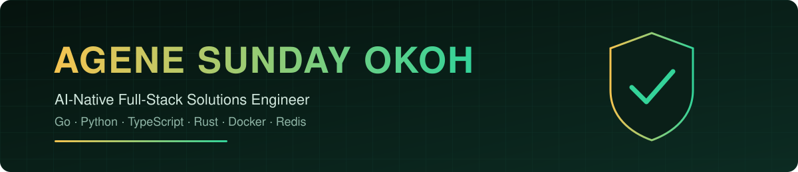

<div align="center">




<br/><br/>

<a href="mailto:agenesunday143@gmail.com"></a>
<a href="https://agene-okoh.vercel.app/"></a>
<a href="https://github.com/asobuilds?tab=repositories"></a>

</div>

<br/>

## About Me

I'm **Agene Sunday Okoh**, a freelance software engineer and fellow of the **Learn2Earn Nigeria (L2E)** programme, Otukpo Campus. I work AI-native: I use AI as leverage to design, build and ship dependable software, with **Go** as my main language and Python, TypeScript, React and Rust alongside it.

I like building tools that people actually use: learning platforms for fellow learners, marketplaces for farmers, and command-line utilities written from scratch. I also hold a B.A. in Philosophy, which is where my habit of breaking problems down before writing code comes from.

```go
package main

import "fmt"

type SolutionsArchitect struct {
	Name        string
	Role        string
	Location    string
	EngineStack []string
	Philosophy  string
}

func (s SolutionsArchitect) Deploy() {
	fmt.Printf("%s | %s | %s\n", s.Name, s.Role, s.Location)
	fmt.Println(s.Philosophy)
}

func main() {
	me := SolutionsArchitect{
		Name:        "Agene Sunday Okoh",
		Role:        "AI-Native Full-Stack Solutions Engineer",
		Location:    "Nigeria",
		EngineStack: []string{"Go", "Python", "TypeScript", "Rust", "Docker", "Redis"},
		Philosophy:  "Build resilient, production-grade pipelines that deliver absolute leverage.",
	}
	me.Deploy()
}
What I Build
Service	What you get
Full-Stack Web Apps	Responsive applications from database to interface: dashboards, marketplaces, learning platforms
Backend & APIs	Clean, tested services in Go and Python with PostgreSQL, Supabase or SQLite
CLI Tools & Systems Programming	Fast command-line utilities built from scratch, with proper test suites
Resilient Systems	Software designed for constrained networks and real-world reliability
Tech Stack
<div align="center">
Languages


Frameworks & Frontend


Data & Infrastructure


Tooling


</div>
Featured Projects
Nativity Guard: Civic Safety Infrastructure (flagship)
Enterprise civic safety infrastructure for constrained networks.

Built for low-bandwidth, high-reliability environments

Designed for civic and public-safety use cases

(Add 2–3 more real bullets here when ready)

L2E CodeStudy: Learning Platform
A platform I built for my fellow L2E learners, and my first real deployed application.

https://img.shields.io/badge/Go-00ADD8?style=flat-square&logo=go&logoColor=white
https://img.shields.io/badge/JavaScript-F7DF1E?style=flat-square&logo=javascript&logoColor=black
https://img.shields.io/badge/HTML5-E34F26?style=flat-square&logo=html5&logoColor=white
https://img.shields.io/badge/CSS3-1572B6?style=flat-square&logo=css3&logoColor=white

Four learning stages with randomized questions and a hint system

Real Go code execution through the Piston API

Progress bars, confetti and a dark dashboard UI

Go backend serving a static HTML/CSS/JS frontend

AGRO-SHIELD: Farmer & Buyer Marketplace (team project)
A marketplace that connects farmers directly with buyers, with an AI assistant for crop diagnosis.

https://img.shields.io/badge/HTML5-E34F26?style=flat-square&logo=html5&logoColor=white
https://img.shields.io/badge/CSS3-1572B6?style=flat-square&logo=css3&logoColor=white
https://img.shields.io/badge/JavaScript-F7DF1E?style=flat-square&logo=javascript&logoColor=black

Marketplace, product pages, cart and sales tracking

Buyer and seller negotiation chat, plus notifications

Storage and inventory management with a live dashboard

AI crop-diagnosis assistant

My focus: front-end quality, CSS architecture and UX improvements

Student Wellness App: Local-First
A privacy-friendly wellness app for students that keeps data on the device.

https://img.shields.io/badge/Go-00ADD8?style=flat-square&logo=go&logoColor=white
https://img.shields.io/badge/React-61DAFB?style=flat-square&logo=react&logoColor=black
https://img.shields.io/badge/TypeScript-3178C6?style=flat-square&logo=typescript&logoColor=white
https://img.shields.io/badge/SQLite-003B57?style=flat-square&logo=sqlite&logoColor=white

Layered architecture: Go backend, React + TypeScript + Vite frontend

Local-first storage with SQLite

DevQuest: Living Campus Dashboard (in progress)
A real-time "living campus" dashboard for L2E fellows.

https://img.shields.io/badge/Go-00ADD8?style=flat-square&logo=go&logoColor=white
https://img.shields.io/badge/Next.js-000000?style=flat-square&logo=nextdotjs&logoColor=white
https://img.shields.io/badge/Supabase-3ECF8E?style=flat-square&logo=supabase&logoColor=white
https://img.shields.io/badge/Tailwind-06B6D4?style=flat-square&logo=tailwindcss&logoColor=white

Planned features: auth, live status, a quest board, guilds and skill trees

Foundation in place: migrations, database pool and health endpoint

CampusFlow: Helpdesk Ticket Manager (L2E team sprint)
A Python command-line helpdesk ticket manager built in a 6-hour, two-engineer sprint.

https://img.shields.io/badge/Python-3776AB?style=flat-square&logo=python&logoColor=white
https://img.shields.io/badge/Tested_with-unittest-34D399?style=flat-square

My part (Engineer A): ticket creation, input validation, priority engine and the matching tests

Worked in GitHub issues, feature branches and pull-request reviews

View Code

ASCII Art Engine: Command-Line Rendering Tool (team project)
A CLI and web tool that renders styled ASCII art from text, built from scratch with no external art libraries.

https://img.shields.io/badge/Go-00ADD8?style=flat-square&logo=go&logoColor=white
https://img.shields.io/badge/CLI_Tool-0C2B22?style=flat-square&logo=gnubash&logoColor=white
https://img.shields.io/badge/Test_Suite-34D399?style=flat-square&logoColor=06130E

Renders text with bitmap banner files

--output=<file> writes results to disk

--color=<color> applies ANSI colouring

--align=<type> aligns output in the terminal

Also served over HTTP with Go's net/http

Structured as an internal package with tests per function

go-reloaded: Text Transformation Tool
A Go CLI that fixes and transforms text automatically.

https://img.shields.io/badge/Go-00ADD8?style=flat-square&logo=go&logoColor=white

Converts hex and binary numbers to decimal

Applies case commands (upper, lower, capitalize)

Fixes punctuation spacing, normalizes quotes and corrects a / an

How I Work
<div align="center">
1. Discover	2. Plan	3. Build	4. Launch & Support
We talk through your goals	You get a clear scope and timeline	I build in steps and share progress	I deploy, hand over and stay available
</div>
GitHub Activity
<div align="center"> </div>
Let's Work Together
<div align="center">
I'm open to freelance projects and collaboration.
Have an idea you want to bring to life? Tell me about it.

<a href="mailto:agenesunday143@gmail.com?subject=Project%20Inquiry"></a>
<a href="https://agene-okoh.vercel.app/"></a>

</div> ```
